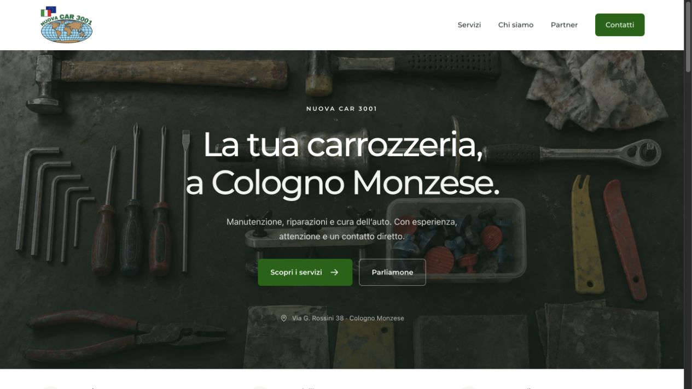
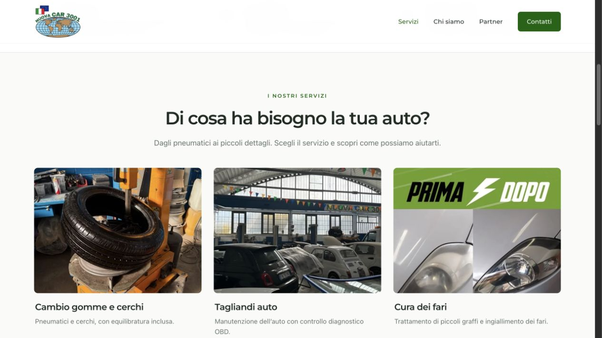
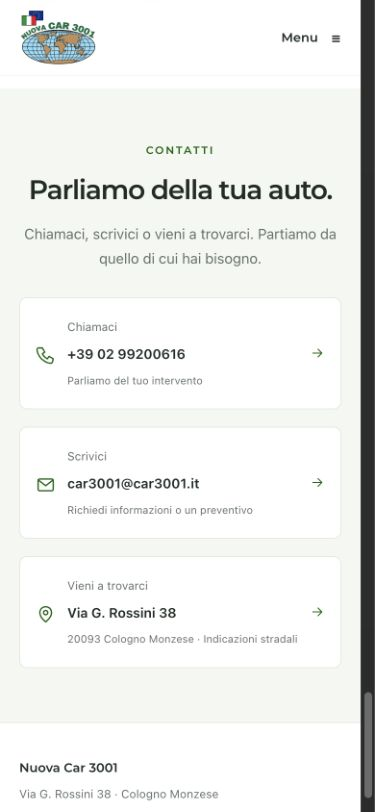

# Audit e implementazione SEO / GEO — Nuova Car 3001

Verifica del 15 ottobre 2026. Repository: `car3001`, branch iniziale `master`, nessuna modifica locale preesistente rilevata. Interventi locali; nessuna pubblicazione o modifica DNS effettuata.

## Revisione grafica e leggibilità

Su richiesta dell'utente la presentazione è stata alleggerita, recuperando il carattere fotografico e minimale del sito precedente. La home usa ora una copertina con titolo e descrizione brevi, navigazione alle sezioni, sei schede fotografiche sintetiche, presentazione con foto della carrozzeria, marchi compatti, FAQ apribili e tre collegamenti evidenti per telefono, email e indicazioni.

Le pagine interne hanno tipografia, spaziature e componenti coerenti. I servizi mostrano subito foto e sintesi, poi lavorazioni e richiesta di preventivo; l'approfondimento si apre senza JavaScript. Le FAQ e la tabella di confronto usano `details` nativi. Sono state rimosse ripetizioni e introduzioni lunghe dalle sezioni di presentazione, senza aggiungere testo nascosto destinato ai crawler.

I nuovi testi brevi sono in `src/data/site.json`: `presentation`, `services[].displayName` e `services[].cardDescription`. Descrizioni approfondite, dati aziendali e metadati restano negli stessi sorgenti condivisi. I grafi Service usano descrizioni coerenti con le schede sintetiche o il dettaglio visibile nella pagina dedicata.

La base tecnica resta attiva: undici pagine statiche, un H1 per pagina, heading coerenti, canonical, metadati social, breadcrumb, sitemap, JSON-LD e risorse Markdown. I percorsi GitHub Pages restano supportati. La grafica usa CSS dedicato; rimossi Bootstrap CSS e Roboto Slab dalle richieste del browser, mantenendo Montserrat e i caratteri di sistema.

Verificati menu e collegamenti alle sezioni, pagina servizio, apertura delle FAQ e contatti da telefono a 390 px, senza scorrimento orizzontale. Build, controlli su undici pagine/280 riferimenti locali e cinque test automatici completati. Le anteprime sono in `seo/preview-desktop.jpg`, `seo/preview-services.jpg` e `seo/preview-mobile.jpg`. Il sito pubblico richiede un nuovo push/deploy per ricevere queste modifiche.

## Correzione della pubblicazione su GitHub Pages

Dopo la pubblicazione all'indirizzo `https://benfrost-20.github.io/car3001/` è stato riscontrato un errore introdotto nella prima implementazione: risorse e link interni iniziavano con `/`, saltando la sottocartella `/car3001`. Il browser cercava quindi CSS, immagini e pagine alla radice dell'account GitHub. I metadati puntavano inoltre al dominio provvisorio car3001.it.

La correzione supporta URL di pubblicazione con o senza sottocartella. Il valore predefinito in `src/data/site.json` è ora `https://benfrost-20.github.io/car3001`. La variabile `SITE_URL` può sostituirlo durante la build. Un unico percorso base viene applicato a risorse, srcset, navigazione, breadcrumb, canonical, Open Graph, JSON-LD, sitemap, robots e risorse Markdown. Gli output restano direttamente in `docs/` e `dist/`.

Il server locale riproduce il percorso `/car3001/`; non serve più soltanto la radice `/`, che aveva nascosto il difetto nella prima verifica. Aggiunti test per GitHub Pages, dominio proprio, sottocartella multipla e rilevamento dei link che escono dal percorso del sito. Cinque test superati; 42 URL locali verificati via HTTP con risposta 200, tipi MIME corretti, redirect e 404 verificati. Il browser locale mostra nuovamente logo, copertina, stili e navigazione funzionanti sotto `/car3001/`.

Aggiunto `.github/workflows/pages.yml`, che legge `base_url` dall'azione ufficiale `configure-pages`, genera e controlla il sito e pubblica l'artefatto `dist`. Per usarlo selezionare **Settings → Pages → Build and deployment → Source: GitHub Actions**. In alternativa, il contenuto aggiornato di `docs/` resta pubblicabile dalla branch. La correzione è locale e richiede un nuovo push/pubblicazione per aggiornare il sito pubblico. [Workflow GitHub Pages](https://docs.github.com/en/pages/getting-started-with-github-pages/using-custom-workflows-with-github-pages), [output base_url ufficiale](https://github.com/actions/configure-pages/blob/v5/action.yml).

Il file robots del progetto si trova in `/car3001/robots.txt`: i crawler consultano il robots alla radice dell'host, quindi per controllare il crawling su GitHub Pages occorre gestire il sito principale dell'account o usare un dominio dedicato. La sitemap del progetto può essere inviata direttamente ai motori di ricerca.

## Audit prima delle modifiche

| Area | Stato rilevato | Conseguenza |
| --- | --- | --- |
| Stack | Template Start Bootstrap Agency, Bootstrap 5.2.3, Pug/Sass e JavaScript; sito effettivo in HTML statico sotto `docs/`. | Non è una SPA: il testo è disponibile nell'HTML iniziale. |
| Sorgenti e build | `src/pug/index.pug` e gli stili sorgente erano ancora il template inglese, mentre `docs/` conteneva la versione italiana personalizzata. La build scriveva in `dist/`. | Ricostruendo dai sorgenti si perdeva il sito aggiornato. |
| Rotte | Una sola pagina `/`, con sezioni a frammento; i sei servizi si aprivano in modali Bootstrap. | I servizi non avevano URL autonomi. I dettagli erano nell'HTML ma nascosti, con interazione dipendente da JavaScript; non è corretto considerarli contenuti assenti dall'HTML. |
| Metadata | Title `NUOVA CAR 3001`, descrizione generica, assenza di canonical, Open Graph e Twitter Card. | Identità locale e intento della pagina poco espliciti. |
| Heading | Un H1 `Benvenuti!`; passaggi H2 → H4; alcuni sottotitoli decorativi usavano H3. | Gerarchia dei contenuti poco chiara. |
| Crawl e schema | Nessun robots, sitemap, llms o JSON-LD. | Mancavano gli indici e una descrizione strutturata dell'attività. |
| Immagini | 28 elementi immagine, 15 riferimenti a file inesistenti; nessuna dimensione HTML esplicita. Header PNG circa 2,33 MB, logo PNG circa 1,22 MB. | Richieste fallite, spazio non riservato e trasferimenti evitabili. |
| Entità | Social segnaposto, affermazioni generiche su certificazioni non identificate. | Collegamenti inutilizzabili e dichiarazioni non documentate. |

La gerarchia iniziale era `/` → punti di forza (`#services`), servizi (`#portfolio` e `#portfolioModal1`…`6`), prodotti (`#products`), assicurazioni (`#insurance`), chi siamo (`#about`), contatti (`#contact`).

## Interventi eseguiti

1. Sostituita la build del template con un generatore statico Node senza dipendenze npm. Grafica, logo, colori, fotografie disponibili e licenza MIT conservati. `src/` è ora il sorgente effettivo; `docs/` e `dist/` sono output equivalenti della stessa build.
2. Centralizzati in `src/data/site.json` dominio, identità, contatti, sede, prezzi, marchi, assicurazioni, social, testi e metadata. I riferimenti `{{name}}`, `{{city}}`, `{{streetAddress}}`, `{{postalCode}}`, `{{telephoneLabel}}`, `{{email}}` vengono espansi in fase di build. FAQ, markup e file AI riusano gli stessi dati.
3. Conservati gli importi provvisori nel file di configurazione con `pricing.enabled: false`. Finché il listino non viene confermato, nessun prezzo viene pubblicato nelle pagine, nel JSON-LD o nei file Markdown. `startingPrice: null` mantiene il servizio su preventivo anche attivando il listino.
4. Create 11 pagine statiche, con navigazione tramite link HTML e breadcrumb nelle pagine interne. I precedenti frammenti principali della home restano disponibili; i sei ID delle vecchie modali identificano ora le schede visibili. I dettagli si aprono su pagine autonome. Rimossi caroselli di immagini mancanti e social segnaposto.
5. Aggiunti un H1 descrittivo per pagina, gerarchia senza salti, sezioni denominate, articoli per le schede dei servizi, address, figure/figcaption, tabelle con caption e scope, elenchi e collegamento per saltare al contenuto. I div residui servono alla griglia e all'impaginazione.
6. Generati title unici (massimo 60 caratteri), description uniche (140–155 caratteri), canonical assoluti, Open Graph e Twitter Card completi. Le immagini social hanno URL assoluto, alt e dimensioni.
7. Nella prima revisione erano stati aggiunti paragrafi introduttivi di 40–60 parole. La successiva richiesta dell'utente privilegia una presentazione minimale: home e schede usano sintesi brevi, mentre le descrizioni specifiche delle lavorazioni restano nelle pagine dei servizi e negli approfondimenti apribili. Tabella di confronto e FAQ sono accessibili senza JavaScript.
8. Implementati Organization/AutoBodyShop, WebSite, WebPage, Service, BreadcrumbList, FAQPage, AboutPage, ContactPage, CollectionPage e ItemList. Offer/PriceSpecification vengono emessi solo per prezzi abilitati. `sameAs` appare soltanto con profili ufficiali configurati.
9. Generata sitemap XML dalle rotte, con priorità e lastmod basato sull'impronta dell'HTML e delle immagini collegate. Il registro `seo/page-history.json` conserva le date quando i contenuti non cambiano. Il valore iniziale registra questa revisione, senza retrodatare nuove pagine.
10. Aggiunti robots, llms, llms-full, versioni Markdown per ciascuna pagina e relazioni HTML `alternate` e `describedby`. Gli elenchi llms puntano alle risorse Markdown, secondo la proposta attuale di llmstxt.org.
11. Convertiti gli asset fotografici e il logo in WebP con varianti responsive, alt contestuali, width/height, caricamento differito sotto la prima schermata e priorità per le immagini principali. Le versioni principali passano da **4.061.856 a 461.292 byte: −88,6%**, esclusi varianti aggiuntive e JPEG social. Il JPEG 1200×630 per la condivisione è mantenuto per compatibilità.
12. Rimossi Font Awesome e il JavaScript Bootstrap non più necessario. Il piccolo script locale gestisce solo il menu mobile, che resta accessibile senza JavaScript. L'iframe Google Maps è sostituito dal link alle indicazioni. Dopo la revisione grafica rimane soltanto Montserrat da Google Fonts; il layout usa CSS dedicato.

## Mappa finale

| Rotta | Contenuto e schema specifico |
| --- | --- |
| `/` | Identità locale, servizi, marchi, collaborazioni, contatti; Organization/AutoBodyShop, WebSite, WebPage, ItemList e Service. |
| `/servizi/` | Indice con schede e tabella; CollectionPage, ItemList e Service. |
| `/servizi/cambio-gomme-cerchi/` | Pneumatici, cerchi ed equilibratura; Service. |
| `/servizi/tagliandi-auto/` | Tagliando e diagnostica OBD; Service. |
| `/servizi/lucidatura-fari/` | Piccoli graffi e ingiallimento fari; Service. |
| `/servizi/pulizia-lucidatura-auto/` | Lavaggio/aspirazione tramite partner, igienizzazione su richiesta e lucidatura; Service. |
| `/servizi/levabolli/` | Grandine e piccole ammaccature senza verniciatura; Service. |
| `/servizi/elettrauto/` | Sensori di parcheggio, dash cam e luci LED interne; Service. |
| `/chi-siamo/` | Presentazione, esperienza e sede; AboutPage. |
| `/contatti/` | Contatti e indicazioni; ContactPage. |
| `/faq/` | Sei domande e risposte; FAQPage. |

Le rotte della tabella sono logiche: su GitHub Pages sono precedute da `/car3001`. Tutte le pagine interne hanno BreadcrumbList. Ogni rotta ha una versione `index.md`; le pagine HTML sono gli URL canonici inseriti nella sitemap.

## Scelte sui dati strutturati e sulle aspettative

Non sono stati creati Article/BlogPosting perché mancano articoli, autori e date editoriali documentate; non sono stati creati Product perché il sito presenta servizi. AggregateRating, recensioni, identificativi Wikidata, certificazioni e registri non sono stati inventati. La struttura potrà essere estesa quando esisteranno contenuti reali e verificati. `sameAs` è omesso con l'elenco social vuoto.

FAQPage descrive le risposte visibili. Non è una promessa di risultati arricchiti: Google ha ritirato la visualizzazione dei FAQ rich result dal 7 maggio 2026. [Aggiornamenti ufficiali Google](https://developers.google.com/search/updates).

llms.txt è una proposta di interoperabilità, non un requisito di posizionamento. Google precisa che non servono file AI speciali per comparire nelle proprie funzioni generative; contenuto accessibile, collegamenti interni e dati coerenti restano fondamentali. [Google AI features](https://developers.google.com/search/docs/appearance/ai-features), [proposta llms.txt v2](https://llmstxt.org/).

Le priorità nella sitemap sono incluse come richiesto, ma Google le ignora. Le date devono invece riflettere cambiamenti effettivi: la build conserva quelle precedenti per contenuti identici. [Documentazione sitemap Google](https://developers.google.com/search/docs/crawling-indexing/sitemaps/build-sitemap).

## Verifiche e limiti

- `npm run build`: completata, 11 pagine in entrambi gli output.
- `npm run check`: completato, 11 pagine e 280 riferimenti locali verificati; heading, metadati, immagini, frammenti, JSON-LD, FAQ, sitemap, robots e Markdown.
- `npm test`: cinque test superati. Verificati stabilità lastmod, aggiornamento selettivo dei contenuti, prezzi abilitati/disabilitati, propagazione di dominio/telefono/email/social, URL con sottocartella e rilevamento di link fuori dal percorso del sito.
- Parsing indipendente con HTMLParser e XML ElementTree: pagine e sitemap coerenti; namespace, priorità e date validi.
- Controllo browser locale: home, navigazione mobile, indice servizi e pagina cambio gomme; menu desktop verificato e nessun errore nella console osservata.
- Il codice JSON-LD è stato verificato sintatticamente e rispetto ai dati visibili. Non è stata eseguita una validazione esterna tramite Rich Results Test o Schema Markup Validator; questi strumenti vanno usati anche sugli URL realmente pubblicati.
- Non sono stati misurati dati reali di Core Web Vitals, ranking o citazioni. Il risparmio riportato riguarda i file immagine, non un punteggio Lighthouse.
- La pagina GitHub Pages pubblicata è stata ispezionata e ha confermato il difetto dei percorsi. La correzione è stata verificata localmente sotto lo stesso prefisso; il sito pubblico richiede un nuovo deploy.

## Informazioni e materiali da completare

1. Il sito attuale usa `https://benfrost-20.github.io/car3001`. Per passare a un dominio dedicato confermare dominio, DNS e redirect; cambiare `url` in `site.json` oppure lasciare che il workflow legga l'URL configurato in GitHub Pages.
2. Confermare i prezzi provvisori e cosa comprendono, eventuali condizioni e trattamento IVA; in particolare il prezzo di partenza della pulizia non va attribuito automaticamente alla lucidatura. Poi attivare `pricing.enabled`.
3. Confermare contatti, marchi Standox/3M, collaborazioni Unipol/Sara/Generali e la dichiarazione di oltre 50 anni di esperienza dei soci; derivano dai testi esistenti.
4. Inserire URL ufficiali dei profili social, orari verificati, ragione sociale e dati identificativi aziendali. Non sono stati dedotti da directory non ufficiali.
5. Fornire fotografie reali del team, della sede e delle lavorazioni, oltre alle foto già disponibili. Non sono state inventate immagini o gallerie sostitutive.
6. Fornire certificazioni identificabili e relativi riferimenti, prima di reinserire le dichiarazioni di carrozzeria certificata o prodotti ecosostenibili.
7. Completare informative privacy/cookie e note legali con testi corretti, quindi collegarle nei layout. Non sono state generate dichiarazioni legali senza dati aziendali.
8. Sul servizio di hosting: pubblicare l'output, confermare HTTPS/redirect/codici HTTP/tipi MIME/accesso bot, inviare la sitemap a Google Search Console e Bing Webmaster Tools e allineare il profilo Business dell'attività.

## Codice generato: llms.txt

Il file sorgente richiesto è `public/llms.txt`; la build lo copia nella radice di `docs/` e `dist/`. Lo stesso vale per robots e llms-full. Questi file sono generati: le informazioni si aggiornano in `site.json`.

```markdown
# Nuova Car 3001

> Nuova Car 3001 è una carrozzeria a Cologno Monzese, in Via G. Rossini 38. I servizi comprendono cambio gomme e cerchi, tagliandi con diagnostica OBD, trattamento fari, pulizia e lucidatura, levabolli ed elettrauto. Per valutare l'intervento sulla tua auto e richiedere un preventivo puoi contattare direttamente la carrozzeria.

Sede: Via G. Rossini 38, 20093 Cologno Monzese (MI), Italia.
Telefono: +39 02 99200616. Email: car3001@car3001.it.
Marchi dei prodotti indicati: Standox, 3M. Partner assicurativi indicati: Unipol, Sara, Generali.
I prezzi non sono pubblicati: richiedere un preventivo alla carrozzeria.
Le risorse seguenti sono versioni Markdown delle pagine pubbliche, generate dagli stessi dati del sito.

## Pagine principali

- [Nuova Car 3001](https://benfrost-20.github.io/car3001/index.md): Nuova Car 3001 a Cologno Monzese: cambio gomme, tagliandi, lucidatura fari, pulizia auto, levabolli ed elettrauto. Contattaci per un preventivo auto.
- [Servizi](https://benfrost-20.github.io/car3001/servizi/index.md): I servizi di Nuova Car 3001 a Cologno Monzese: pneumatici, tagliandi OBD, fari, pulizia, levabolli ed elettrauto. Leggi i dettagli e chiedi un preventivo.
- [Chi siamo](https://benfrost-20.github.io/car3001/chi-siamo/index.md): Conosci Nuova Car 3001, carrozzeria a Cologno Monzese in Via G. Rossini 38. Esperienza nel settore auto, servizi e contatti per informazioni e preventivi.
- [Contatti](https://benfrost-20.github.io/car3001/contatti/index.md): Contatta Nuova Car 3001: telefono, email e indicazioni per Via G. Rossini 38 a Cologno Monzese. Richiedi informazioni e un preventivo per i servizi auto.
- [Domande frequenti](https://benfrost-20.github.io/car3001/faq/index.md): Sede, servizi, cambio gomme, tagliandi OBD, pulizia auto e preventivi di Nuova Car 3001 a Cologno Monzese. Consulta le FAQ e contatta la carrozzeria.

## Servizi

- [Cambio gomme e cerchi](https://benfrost-20.github.io/car3001/servizi/cambio-gomme-cerchi/index.md): Cambio gomme e cerchi con equilibratura da Nuova Car 3001 a Cologno Monzese. Scopri il servizio e contattaci per un preventivo per la tua auto in officina.
- [Tagliandi auto](https://benfrost-20.github.io/car3001/servizi/tagliandi-auto/index.md): Tagliandi auto con controllo diagnostico OBD incluso da Nuova Car 3001 a Cologno Monzese. Contattaci per informazioni e un preventivo per il tuo veicolo.
- [Verniciatura e lucidatura fari](https://benfrost-20.github.io/car3001/servizi/lucidatura-fari/index.md): Verniciatura e lucidatura fari a Cologno Monzese con Nuova Car 3001. Trattamento per graffi e ingiallimento: scopri il servizio e richiedi un preventivo.
- [Pulizia e lucidatura auto](https://benfrost-20.github.io/car3001/servizi/pulizia-lucidatura-auto/index.md): Pulizia auto a Cologno Monzese: lavaggio e aspirazione tramite partner, igienizzazione su richiesta. Scopri il servizio e contatta Nuova Car 3001.
- [Levabolli](https://benfrost-20.github.io/car3001/servizi/levabolli/index.md): Levabolli a Cologno Monzese per grandine e piccole ammaccature che non richiedono verniciatura. Contatta Nuova Car 3001 per valutazione e preventivo.
- [Elettrauto](https://benfrost-20.github.io/car3001/servizi/elettrauto/index.md): Elettrauto a Cologno Monzese: sensori di parcheggio, installazione dash cam e luci interne LED. Contatta Nuova Car 3001 per informazioni e preventivi.

## Optional

- [Contenuto completo in un file](https://benfrost-20.github.io/car3001/llms-full.txt): raccolta delle versioni Markdown delle pagine.
- [Mappa del sito](https://benfrost-20.github.io/car3001/sitemap.xml): indice degli URL HTML canonici.
```

## Codice generato: robots.txt

Tutti gli user agent appartengono a un gruppo con le stesse regole; i crawler specifici non perdono i blocchi delle rotte riservate. Le rotte API/admin/private non esistono attualmente: le direttive ne limitano il crawling se aggiunte in futuro e non sostituiscono il controllo degli accessi.

```text
# Regole comuni per tutti i crawler, inclusi ricerca e AI.
User-agent: *
User-agent: Googlebot
User-agent: Bingbot
User-agent: GPTBot
User-agent: OAI-SearchBot
User-agent: ChatGPT-User
User-agent: PerplexityBot
User-agent: Perplexity-User
User-agent: ClaudeBot
User-agent: Claude-SearchBot
User-agent: Claude-User
User-agent: CCBot
User-agent: Google-Extended
Allow: /car3001/
Disallow: /car3001/api/
Disallow: /car3001/admin/
Disallow: /car3001/private/

Sitemap: https://benfrost-20.github.io/car3001/sitemap.xml
```

## JSON-LD di riferimento: attività e sito

Estratto dal grafo effettivo della home. I grafi completi sono in `seo/examples/home.json`, `service.json` e `faq.json`, rigenerati automaticamente.

```json
{
  "@context": "https://schema.org",
  "@graph": [
    {
      "@type": [
        "Organization",
        "AutoBodyShop"
      ],
      "@id": "https://benfrost-20.github.io/car3001/#organization",
      "name": "Nuova Car 3001",
      "url": "https://benfrost-20.github.io/car3001/",
      "telephone": "+390299200616",
      "email": "car3001@car3001.it",
      "description": "Nuova Car 3001 è una carrozzeria a Cologno Monzese, in Via G. Rossini 38. I servizi comprendono cambio gomme e cerchi, tagliandi con diagnostica OBD, trattamento fari, pulizia e lucidatura, levabolli ed elettrauto. Per valutare l'intervento sulla tua auto e richiedere un preventivo puoi contattare direttamente la carrozzeria.",
      "address": {
        "@type": "PostalAddress",
        "streetAddress": "Via G. Rossini 38",
        "postalCode": "20093",
        "addressLocality": "Cologno Monzese",
        "addressRegion": "MI",
        "addressCountry": "IT"
      },
      "logo": {
        "@type": "ImageObject",
        "url": "https://benfrost-20.github.io/car3001/assets/img/logo.webp",
        "width": 440,
        "height": 325
      },
      "image": "https://benfrost-20.github.io/car3001/assets/img/header.webp"
    },
    {
      "@type": "WebSite",
      "@id": "https://benfrost-20.github.io/car3001/#website",
      "url": "https://benfrost-20.github.io/car3001/",
      "name": "Nuova Car 3001",
      "inLanguage": "it",
      "publisher": {
        "@id": "https://benfrost-20.github.io/car3001/#organization"
      }
    }
  ]
}
```

## JSON-LD di riferimento: servizio e breadcrumb

Estratto dalla pagina cambio gomme. In assenza di prezzi confermati il servizio non emette un'offerta con importo.

```json
{
  "@context": "https://schema.org",
  "@graph": [
    {
      "@type": "BreadcrumbList",
      "@id": "https://benfrost-20.github.io/car3001/servizi/cambio-gomme-cerchi/#breadcrumb",
      "itemListElement": [
        {
          "@type": "ListItem",
          "position": 1,
          "name": "Home",
          "item": "https://benfrost-20.github.io/car3001/"
        },
        {
          "@type": "ListItem",
          "position": 2,
          "name": "Servizi",
          "item": "https://benfrost-20.github.io/car3001/servizi/"
        },
        {
          "@type": "ListItem",
          "position": 3,
          "name": "Cambio gomme e cerchi",
          "item": "https://benfrost-20.github.io/car3001/servizi/cambio-gomme-cerchi/"
        }
      ]
    },
    {
      "@type": "Service",
      "@id": "https://benfrost-20.github.io/car3001/servizi/cambio-gomme-cerchi/#service",
      "name": "Cambio gomme e cerchi",
      "serviceType": "Cambio gomme e cerchi",
      "description": "La lavorazione può riguardare pneumatici stagionali oppure pneumatici nuovi o usati, con sostituzione dei cerchi quando prevista nell'intervento concordato. L'equilibratura è inclusa nel servizio presentato. Prima di richiedere il preventivo, specifica alla carrozzeria se ti interessa il cambio degli pneumatici, dei cerchi o di entrambi.",
      "url": "https://benfrost-20.github.io/car3001/servizi/cambio-gomme-cerchi/",
      "image": "https://benfrost-20.github.io/car3001/assets/img/gomma.webp",
      "provider": {
        "@id": "https://benfrost-20.github.io/car3001/#organization"
      },
      "areaServed": {
        "@type": "City",
        "name": "Cologno Monzese"
      }
    }
  ]
}
```

La funzione che abilita le offerte è in `scripts/lib/site.js`: emette Offer con `itemOffered`, `seller`, `url`, descrizione qualificata e `PriceSpecification.minPrice`, evitando di rappresentare il prezzo iniziale come un importo fisso per qualsiasi intervento.

## JSON-LD di riferimento: FAQ

Le domande e le risposte derivano dalla stessa funzione che produce il contenuto visibile.

```json
{
  "@context": "https://schema.org",
  "@graph": [
    {
      "@type": "FAQPage",
      "@id": "https://benfrost-20.github.io/car3001/faq/#webpage",
      "url": "https://benfrost-20.github.io/car3001/faq/",
      "name": "Domande frequenti sui servizi auto | Nuova Car 3001",
      "description": "Sede, servizi, cambio gomme, tagliandi OBD, pulizia auto e preventivi di Nuova Car 3001 a Cologno Monzese. Consulta le FAQ e contatta la carrozzeria.",
      "inLanguage": "it",
      "isPartOf": {
        "@id": "https://benfrost-20.github.io/car3001/#website"
      },
      "about": {
        "@id": "https://benfrost-20.github.io/car3001/#organization"
      },
      "dateModified": "2026-10-15T11:26:34.953Z",
      "breadcrumb": {
        "@id": "https://benfrost-20.github.io/car3001/faq/#breadcrumb"
      },
      "mainEntity": [
        {
          "@type": "Question",
          "name": "Dove si trova Nuova Car 3001?",
          "acceptedAnswer": {
            "@type": "Answer",
            "text": "Nuova Car 3001 si trova in Via G. Rossini 38, 20093 Cologno Monzese (MI). Nella pagina Contatti trovi il collegamento alle indicazioni stradali."
          }
        },
        {
          "@type": "Question",
          "name": "Quali servizi offre la carrozzeria?",
          "acceptedAnswer": {
            "@type": "Answer",
            "text": "I servizi presentati sono: Cambio gomme e cerchi, Tagliandi auto, Verniciatura e lucidatura fari, Pulizia e lucidatura auto, Levabolli, Elettrauto."
          }
        },
        {
          "@type": "Question",
          "name": "Il cambio gomme comprende l'equilibratura?",
          "acceptedAnswer": {
            "@type": "Answer",
            "text": "Sì. Il servizio di sostituzione pneumatici e/o cerchi presentato da Nuova Car 3001 comprende l'equilibratura."
          }
        },
        {
          "@type": "Question",
          "name": "Il tagliando comprende un controllo diagnostico?",
          "acceptedAnswer": {
            "@type": "Answer",
            "text": "Sì. Il tagliando presentato da Nuova Car 3001 include il controllo diagnostico OBD, il sistema di diagnostica di bordo del veicolo."
          }
        },
        {
          "@type": "Question",
          "name": "Come posso richiedere un preventivo?",
          "acceptedAnswer": {
            "@type": "Answer",
            "text": "Puoi chiamare il numero +39 02 99200616 oppure scrivere a car3001@car3001.it, indicando il veicolo e il servizio desiderato. Lavorazioni e costo finale vanno concordati direttamente con la carrozzeria."
          }
        },
        {
          "@type": "Question",
          "name": "Come viene svolta la pulizia dell'auto?",
          "acceptedAnswer": {
            "@type": "Answer",
            "text": "Il lavaggio e l'aspirazione interna sono proposti tramite un partner di fiducia. L'igienizzazione è disponibile su richiesta; per la lucidatura professionale occorre concordare il relativo intervento."
          }
        }
      ]
    }
  ]
}
```

## Anteprima verificata






